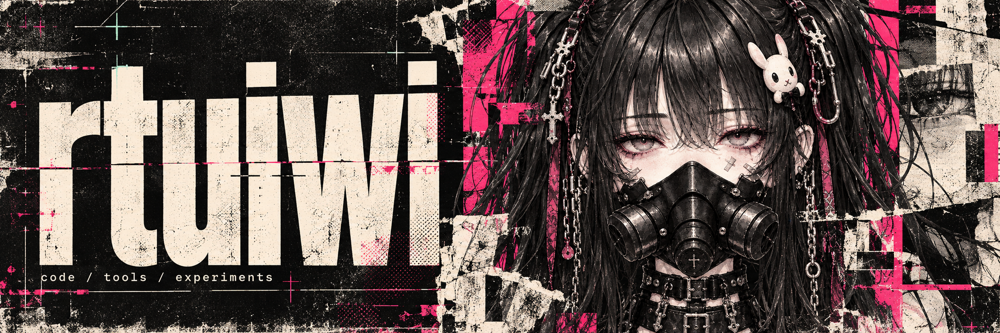

## Привет, я rtuiwi.

Создаю приложения и инструменты, которые решают повседневные задачи.
Локальные программы, автоматизация и эксперименты с данными.

**Python** · **JavaScript** · **HTML / CSS** · **AppleScript**

---

### Проект

[SoundCloud → «Музыка»](https://github.com/rtuiwi/soundcloud-to-apple-music) — приложение для Mac: выбирает треки из Likes и плейлистов SoundCloud и импортирует аудио с обложками в локальную медиатеку «Музыка».

---

### На связи

[Telegram ↗](https://t.me/rtuiwi) · [TikTok ↗](https://tiktok.com/@rtuiwi) · [Репозитории ↗](https://github.com/rtuiwi?tab=repositories)

 

